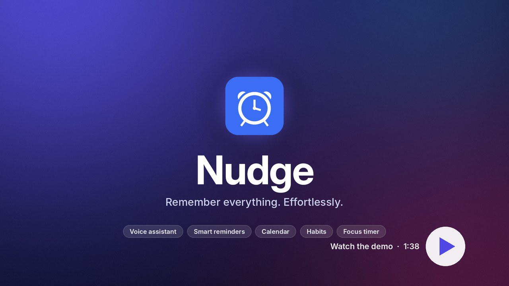

# Nudge — Remember everything. Effortlessly.

**Nudge** is a personal assistant for your day: smart reminders with a Siri-style voice assistant, to-dos,
a task board, notes, habits, a focus timer, a calendar and a password-protected private folder.
Open it on any phone or PC:

**▶ https://deivaprakash56.github.io/Custom-Reminder-Application/**

### 🎬 Product demo (1.5 minutes)

[](https://deivaprakash56.github.io/Custom-Reminder-Application/docs/video.html)

A quick tour of Nudge with music: the voice assistant, smart alerts and snooze, the calendar, the task
board, habits, the focus timer, weekly insights, the private folder and the phone app, built from
**Deivaprakash's** ideas.
**[▶ Watch the demo](https://deivaprakash56.github.io/Custom-Reminder-Application/docs/video.html)** ·
[download the MP4](docs/media/nudge-demo.mp4)

| Edition | Where | Data stored | Reminders |
|---|---|---|---|
| **Phone app** (`docs/`) | GitHub Pages: open the link and "Install" | on that device (optional encrypted sync) | while the app is open, or always with the push server |
| **Push server** (`push-worker/`) | free Cloudflare Worker you deploy | push schedule + encrypted sync blob | push notifications even when the app is closed |
| **PC server** (`server.py`, `static/`) | your Ubuntu PC, `./run.sh` | `data/tasks.db` on the PC | desktop pop-up and sound, even with no browser open |

## Phone app (GitHub Pages)

`docs/` is a static, installable web app (PWA) with an offline cache and a home-screen icon.
GitHub Pages serves it from branch `main`, folder `/docs` (the root `index.html` redirects there too).
Open the link and tap **Install** on the "Install Nudge" bar (phones) or **Install app** in the side menu.
Where the browser can't install by itself, Nudge shows the steps: on **iPhone**, open the link in
Safari, tap **Share** → **Add to Home Screen**; on **Android**, Chrome's **⋮** menu → **Install app**.
Then turn on notifications.

### Organise

- **Sidebar** with a live 12-hour clock and a countdown to your next reminder, search across
  everything, and smart lists: **Today, Scheduled, All, Overdue, Flagged, History**.
- **Folders:** Personal, Work, **Private** and your own folders (pick a colour; edit from the ⋯ button).
- **Reminders** with date, time, repeat (daily, weekdays, weekly, monthly, yearly), early alerts,
  priority, notes, a **checklist of steps**, **photo/file attachments**, and **location triggers**
  ("when I leave work").
- **Calendar:** month and week views; drag a reminder to another day; double-click a day to add one;
  repeating reminders appear on every day they happen.
- **Workspace:** a **To-Do List** (drag to reorder, progress bar), **Things to Do** (To Do / In Progress /
  Done board with drag and drop), and a **Notepad** (autosave, pin, search; select text and tap the bell
  to turn it into a reminder).
- **Habits:** pick the days, check in daily, keep a 🔥 streak; the week's dots show what you kept.
- **Focus timer (Pomodoro):** 25/5, 50/10 or your own lengths, linked to a Things to Do card or to-do;
  a floating mini-timer follows you around the app; minutes are logged per task.
- **Insights:** a weekly summary — completed vs the week before, overdue, focus time, habits kept,
  busiest day, and completions per day — which it can read aloud.
- **History:** everything you completed, plus an activity log; **Undo** for every change.

### Never miss it

- Alerts with **Done / 10 min / Later…**; "Later" offers **smart snooze**: after lunch, this evening,
  tonight, tomorrow morning, next Monday.
- **Nagging mode:** "keep reminding me until I do it" repeats every 5 minutes until you tick it off.
- **Alarm sounds:** chime, bell, marimba, digital, gentle rise, alarm clock, or **your own sound file**,
  with volume.
- **Morning briefing:** at the time you choose, the assistant reads out your day — reminders, overdue
  items, habits and work in progress (on Mondays, last week's summary too).
- **Calendar export:** "Add to calendar (.ics)" or "Google Calendar" on any reminder, or export them all,
  so your phone's own calendar alarms back you up.
- **Push notifications** with the app closed, using the optional companion server (below).

### Voice assistant (mic button or Ctrl+K)

Talk or type in plain English — or **Tamil** (Settings → Voice → தமிழ்). Examples:

- "Remind me to call mom tomorrow at 5 pm", "in 20 minutes remind me to check the oven"
- "Remind me to take out the trash every weekday at 7:30 am", "… every Monday at 7", "… on the 1st #work"
- "… it's urgent", "… and remind me 30 minutes before", "… and keep reminding me until I do it"
- "Remind me to buy milk when I leave work", "… when I get home" (add places in Settings → Places)
- **Follow-ups:** "move it to 8", "make it every week", "put it in my work folder", "rename it to …",
  "actually tomorrow", "6 pm instead", "add it to my calendar", "delete it"
- "Add eggs to my shopping list", "Add redesign the logo to things to do", "Take a note that …"
- "What's on tomorrow?", "What's overdue?", "Brief me", "How was my week?"
- "Start a 25 minute focus on write proposal", "Stop the timer"
- "Add a habit drink water every day", "Check in drink water"
- "Mark call mom as done", "Snooze until this evening", "Undo", "Open calendar", "Lock private folder"
- Tamil: "நாளை மாலை 5 மணிக்கு அம்மாவை அழைக்க நினைவூட்டு", "பால் வாங்க பட்டியலில் சேர்", "நேரம் என்ன"

If you leave out the time it asks "When should I remind you?" and keeps listening. Replies are spoken
(turn off in Settings); hands-free "Hey Nudge" is in Settings. Speech needs Chrome, Edge or Safari;
typing works everywhere. Optional **AI fallback**: when the built-in parser doesn't understand a
sentence, it is sent to Claude (`claude-opus-5-5`) to work out what you meant — add your Anthropic API
key in Settings → AI assistant, or keep the key on the companion server.

### Private folder

Private reminders, notes, checklists and attachments are encrypted with AES-256-GCM. A random data key
is wrapped by your password (PBKDF2-SHA-256, 310,000 rounds) and, if you turn it on, by your device's
**fingerprint / face unlock** (WebAuthn PRF — Chrome on Android, Windows Hello, recent Safari). The
folder locks after 5 minutes. Private reminders still go off while locked, shown as "Private reminder".
There is no password recovery: "Forgot password?" wipes the private items.

### More

- **Home-screen shortcuts** (long-press the icon): New reminder, Voice assistant, Today, Calendar.
- **Share to the app:** share text or a link from another app and save it as a reminder, note or to-do.
- Light/dark themes, 8 accent colours, phone layout, export/import backups (Settings → Backup).
- Tasks from the first version of the app are moved into the Personal folder automatically.

## Beta accounts: sign-in, sign-up and where the data lives

When a server is configured, Nudge shows a **sign-in page** (`docs/login.html`) with **Create account**
and **Forgot password?**. Emails you approved in advance get straight in. Anyone else who signs up
becomes an **access request**: the sign-in page tells them Deivaprakash has been asked to approve
their account, and they can sign in once you approve it. Each account's data
syncs across that person's phone and computer, and still works offline.

### Set it up (once)

1. Deploy the companion worker (steps in the next section). This version adds an `Accounts` store, so
   run `npx wrangler deploy` again if you deployed it before.
2. The name shown to people waiting for approval is `ADMIN_NAME` in `push-worker/wrangler.toml`
   ("Deivaprakash") and `adminName` in `docs/config.js`.
3. Create your admin password (a long random string) and store it on the worker:
   ```bash
   cd push-worker
   node -e "console.log(require('crypto').randomBytes(24).toString('base64url'))"
   npx wrangler secret put ADMIN_TOKEN
   ```
4. Put the worker URL in `docs/config.js` and commit it (it is public; it's not a secret):
   ```js
   window.NUDGE_CONFIG = { api: "https://reminders-push.<you>.workers.dev" };
   ```
   From then on, everyone who opens the app is asked to sign in. With `api: ""` Nudge runs without
   accounts, exactly as before.

### Run the beta (`docs/admin.html`)

Open **https://deivaprakash56.github.io/Custom-Reminder-Application/docs/admin.html**, paste the
server URL and your `ADMIN_TOKEN`, and tap **Connect**. There you can:

- **Access requests**: people who signed up without an invitation. **Approve** lets them sign in right
  away with the password they chose; **Decline** removes the request.
- **Approve emails** in advance: paste testers' addresses. Send them the app link; they tap
  **Create account** and get straight in.
- See every **account**: when they joined, last signed in and last synced, and how much data they have.
- **Reset password**: gives a one-time code (valid 48 hours) to send the tester. They tap
  **Forgot password?**, enter the code and choose a new password. All their other devices are signed out.
- **Pause** or **Resume** an account, **Export** someone's data as JSON (for support or backup), or
  **Delete** an account with all of its data.

### Where the data is stored

| What | Where |
|---|---|
| Accounts, approved emails, sessions, reset codes | One Cloudflare Durable Object (`Accounts`) on your worker |
| Each user's reminders, to-dos, notes, habits, folders | That user's own Durable Object (one per account), up to about 1.8 MB each |
| Private folder | Same place, but **end-to-end encrypted** with the user's private-folder password; the server can't read it |
| Photos/files attached to reminders, custom alarm sounds | Only on the device where they were added (IndexedDB) |
| A working copy of the user's data | The browser's local storage, so Nudge opens instantly and works offline; changes sync when online |

- **Passwords** never leave the device in readable form: the browser stretches them with PBKDF2
  (200,000 rounds) and the server stores a salted hash of that. Six wrong attempts lock sign-in for
  15 minutes. Sessions last 60 days and are renewed while in use; **Sign out** (Settings → Account)
  also removes that account's data from the device.
- **Cost:** Cloudflare's free plan includes Durable Objects with SQLite storage, which is plenty for a
  beta (thousands of users). Watch usage in the Cloudflare dashboard → Workers → `reminders-push`.
- **Backups:** use **Export** in the admin page for individual users. Users can also download their
  own backup in Settings → Backup.
- Data other than the Private folder is readable by whoever controls the Cloudflare account (you),
  like most cloud apps. Tell your testers that, and use the Private folder for sensitive items.

## Companion server (optional): push, sync, AI key

A static site can't wake a closed app or share data between devices. `push-worker/` is a small
Cloudflare Worker (free plan, Durable Objects) that adds:

- **Push notifications** that arrive with the app closed (Web Push, RFC 8291/8292; nagging repeats too).
- **Sync between devices**, end-to-end encrypted with your sync code — the server stores only
  ciphertext. Changes are merged item by item. (Attachments and custom sounds stay on each device.)
- An **AI proxy**, so your Anthropic API key lives on the server instead of in the browser.

Deploy it (needs a free Cloudflare account and Node 18+):

```bash
cd push-worker
npx wrangler login
node gen-vapid.mjs                       # prints the VAPID keys
npx wrangler secret put VAPID_PUBLIC      # paste the public key
npx wrangler secret put VAPID_PRIVATE_JWK # paste the JSON private key
npx wrangler secret put ANTHROPIC_API_KEY # optional, for the AI fallback
npx wrangler deploy                       # prints https://reminders-push.<you>.workers.dev
```

Then in the app: **Settings → Companion server**, paste the URL, tap **Check**, and turn on
**Push notifications** and/or **Sync** (use the same sync code on every device). If you serve the app
from another origin, add it to `ALLOWED_ORIGINS` in `push-worker/wrangler.toml`.

## PC server edition

### Run

```bash
cd ~/Desktop/Claude/task_reminder
./run.sh                 # starts the server and opens http://127.0.0.1:8765
./run.sh --lan           # also reachable from your phone on the same Wi-Fi
python3 server.py --no-desktop   # no desktop pop-ups or sound
```

Keep the terminal open; Ctrl-C stops it. Your tasks are saved in `data/tasks.db`.

### Features

- Add tasks with a due date and time, a reminder offset (at due time, 5/10/15/30 min,
  1 hour or 1 day before), priority, repeat and notes.
- Quick due-time buttons: in 10 min, in 1 hour, tonight 8 PM, tomorrow 9 AM.
- Tasks are grouped as Overdue, Today, Tomorrow, This week, Later, No date and Completed.
  You can filter (Active, Today, Overdue, Upcoming, Completed, All) and search.
- Repeat every day, on weekdays, every week or every month. Ticking a repeating task
  moves it to its next occurrence.
- Snooze (+10 min or +1 hour), edit, delete, and reopen completed tasks.
- Light and dark themes (follows your system), and the layout works on a phone.

### How reminders work

The server checks every 5 s. When a task's reminder time arrives:

1. A **desktop notification** appears through `notify-send`, with the alarm sound
   (`paplay`). High-priority tasks use critical urgency, which stays on screen.
   This works even with no browser open.
2. Every open browser tab shows a **pop-up with Done / Snooze buttons** and plays a
   chime. If you clicked "Enable browser notifications", it also shows a system
   notification.

Each reminder fires once. Snoozing or changing the due time arms it again.
Browsers only allow notifications on `localhost` or HTTPS, so a phone opening the
`--lan` address gets the in-page pop-up and chime but not system notifications.

### Start automatically at login (optional)

```bash
mkdir -p ~/.config/autostart
cat > ~/.config/autostart/task-reminder.desktop <<EOD
[Desktop Entry]
Type=Application
Name=Nudge
Exec=/usr/bin/python3 $HOME/Desktop/Claude/task_reminder/server.py
X-GNOME-Autostart-enabled=true
EOD
```

### API (JSON)

| Method | Path | Body / notes |
|---|---|---|
| GET | `/api/tasks` | `{now, tasks: [...]}` |
| POST | `/api/tasks` | `{title, due?, remind_before?, priority?, repeat?, notes?}` |
| GET / PUT / DELETE | `/api/tasks/<id>` | PUT takes any subset of the fields |
| POST | `/api/tasks/<id>/done` | repeating tasks move to their next occurrence |
| POST | `/api/tasks/<id>/undone` | reopen |
| POST | `/api/tasks/<id>/snooze` | `{minutes}` |

Times are local and look like `2026-11-07T17:30`.

### Tests

```bash
python3 -m unittest discover -s tests -v     # PC server
node --test tests/test_nlp.js                # voice / natural-language parser, incl. Tamil (Node 18+)
node --test tests/test_webpush.mjs           # Web Push encryption against the RFC 8291 test vector
node --test tests/test_worker.mjs            # companion worker: schedule, alarms, nagging, sync
node --test tests/test_accounts.mjs          # beta accounts: access requests, sign-in, lockout, reset, admin
```

## Files

```
docs/              phone app for GitHub Pages: index.html, app.js (UI, storage, vault,
                   reminders, assistant), extras.js (calendar, habits, focus, insights,
                   briefing, location, push, sync, AI, biometrics, sounds, attachments),
                   nlp.js (English + Tamil parser), style.css, sw.js (offline + push), manifest,
                   login.html + auth.js (sign-in / sign-up), admin.html (beta admin), config.js
push-worker/       optional Cloudflare Worker: Web Push, encrypted sync, AI proxy, beta accounts
server.py          HTTP server, JSON API, SQLite store, reminder scheduler
static/index.html  page
static/app.js      UI logic, polling, in-page and browser notifications
static/style.css   styles (light/dark, mobile)
tests/test_app.py  API and reminder tests (PC server)
tests/test_nlp.js  natural-language parser tests
tests/test_webpush.mjs, tests/test_worker.mjs  companion server tests
run.sh             start and open the browser
data/tasks.db      your tasks (created on first run)
```

> **Security:** the PC server edition has no login (the phone app's beta accounts don't apply to it). Keep the default (localhost only), and use `--lan`
> only on a network you trust.
